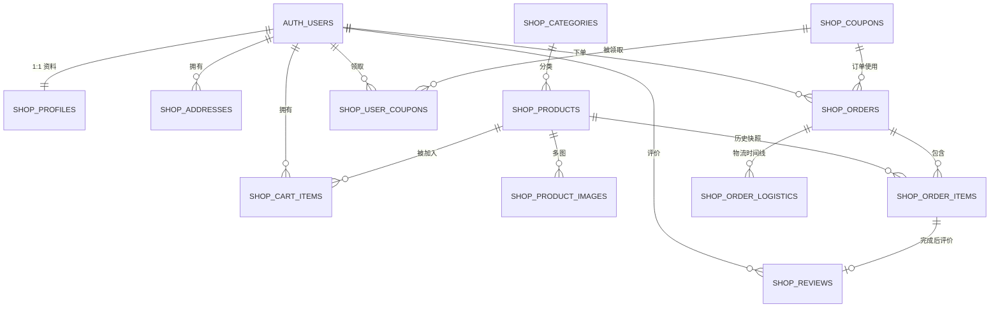

# Mini 在线商城数据库设计

> 课程依据：`d:\网站\03 全栈应用开发.pdf` 中“项目实战 - 在线商城”章节，并在其扩展思路基础上补齐商品筛选、评价、优惠券、物流、商家后台和商品推荐。
>
> 复用现有 Supabase 项目 `blog-demo`，不新建实例、不使用 Node/Express，也不使用 `service_role` 密钥。用户体系直接复用 `auth.users` 和 Supabase Auth。所有商城表统一使用 `shop_` 前缀，避免与博客 `posts/categories`、问答社区 `questions/answers/votes` 重名。

## 1. 设计原则

1. **前端直连 Supabase**：页面通过 `@supabase/supabase-js` 访问数据；需要多表原子操作（下单、取消订单、领取优惠券、商家改状态）时调用安全定义者函数（RPC），函数体本身运行在一个 PostgreSQL 事务中。
2. **权限最小化**：所有业务表开启 RLS；访客只能读取公开商品、分类、评价、优惠券；用户只能操作自己的地址、购物车、订单；商家通过 `shop_profiles.role = 'merchant'` 获得商品与订单管理权限。
3. **订单快照**：订单保存收货地址副本、商品名称、商品图片、下单单价和小计，避免地址删除或商品改价影响历史订单。
4. **库存一致性**：下单在 RPC 内锁定商品行并原子扣减；任一步失败则整个事务回滚；待支付订单取消时恢复库存。库存扣减采用 `UPDATE ... WHERE stock >= quantity`，防止并发超卖。
5. **数据库约束优先**：价格、库存、数量、评分、状态值都由 `CHECK` 约束兜底，前端校验只作为体验优化。
6. **敏感信息隔离**：客户端只持有 `.env` 中的 `VITE_SUPABASE_URL` 与 `VITE_SUPABASE_ANON_KEY`；`.env` 不进入 Git。

## 2. 数据表总览

| 表名 | 用途 | 访客可读 | 登录用户 | 商家 |
|---|---|---:|---:|---:|
| `shop_profiles` | 商城用户资料与角色 | 否 | 仅自己 | 查看全部 |
| `shop_categories` | 商品分类 | 是 | 是 | 管理 |
| `shop_products` | 商品主数据 | 仅上架 | 仅上架 | 全部 |
| `shop_product_images` | 商品多图 | 仅上架商品 | 仅上架商品 | 管理 |
| `shop_addresses` | 收货地址 | 否 | 仅自己 | 无 |
| `shop_cart_items` | 购物车 | 否 | 仅自己 | 无 |
| `shop_coupons` | 优惠券模板（满减） | 仅启用 | 仅启用 | 管理 |
| `shop_user_coupons` | 用户已领优惠券 | 否 | 仅自己 | 无 |
| `shop_orders` | 订单主表与地址快照 | 否 | 仅自己 | 查看全部 |
| `shop_order_items` | 订单商品快照 | 否 | 仅自己订单 | 查看全部 |
| `shop_reviews` | 已完成订单的商品评价 | 是 | 写自己的 | 只读 |
| `shop_order_logistics` | 物流/状态时间线 | 否 | 仅自己订单 | 查看并追加 |

## 3. 实体关系



## 4. 表结构

### 4.1 `shop_profiles` 商城用户资料

| 字段 | 类型 | 约束与说明 |
|---|---|---|
| `id` | `uuid` | 主键，外键 `auth.users(id)`，级联删除 |
| `display_name` | `text` | 非空，1–40 字符，默认“商城用户” |
| `avatar_url` | `text` | 可空 |
| `role` | `text` | 非空，`customer` 或 `merchant`，默认 `customer` |
| `created_at` | `timestamptz` | 默认 `now()` |
| `updated_at` | `timestamptz` | 更新时间由触发器维护 |

注册后由 `auth.users` 触发器自动创建资料。已有用户由脚本末尾的回填语句补齐。用户通过前端不能修改 `role`，角色只能由管理员在 SQL Editor 中设置。

### 4.2 `shop_categories` 商品分类

| 字段 | 类型 | 约束与说明 |
|---|---|---|
| `id` | `uuid` | 主键，`gen_random_uuid()` |
| `name` | `text` | 非空，1–30 字符，唯一 |
| `slug` | `text` | 非空，唯一，用于 URL/筛选 |
| `description` | `text` | 可空 |
| `sort_order` | `integer` | 非空，默认 0，越小越靠前 |
| `created_at` | `timestamptz` | 默认 `now()` |

### 4.3 `shop_products` 商品

| 字段 | 类型 | 约束与说明 |
|---|---|---|
| `id` | `uuid` | 主键 |
| `name` | `text` | 非空，1–80 字符 |
| `description` | `text` | 非空，默认空字符串 |
| `price` | `numeric(12,2)` | 非空，`>= 0` |
| `stock` | `integer` | 非空，`>= 0`，下单时原子扣减 |
| `cover_image_url` | `text` | 列表/订单快照使用的封面图，可空 |
| `category_id` | `uuid` | 外键 `shop_categories(id)`，删除分类时置空 |
| `sales_count` | `integer` | 非空，`>= 0`；下单增加，待支付订单取消时减少 |
| `is_active` | `boolean` | 非空，默认 `true`；`false` 表示已下架 |
| `created_by` | `uuid` | 商家用户 ID，外键 `auth.users(id)`，可空 |
| `created_at` | `timestamptz` | 默认 `now()` |
| `updated_at` | `timestamptz` | 更新时间由触发器维护 |

### 4.4 `shop_product_images` 商品多图

| 字段 | 类型 | 约束与说明 |
|---|---|---|
| `id` | `uuid` | 主键 |
| `product_id` | `uuid` | 非空，外键 `shop_products(id)`，级联删除 |
| `image_url` | `text` | 非空，图片 URL |
| `sort_order` | `integer` | 非空，默认 0，越小越靠前 |
| `created_at` | `timestamptz` | 默认 `now()` |

`cover_image_url` 用于列表和订单快照；详情页按 `sort_order` 读取全部图片。若封面为空，前端可回退到第一张图。

### 4.5 `shop_addresses` 收货地址

| 字段 | 类型 | 约束与说明 |
|---|---|---|
| `id` | `uuid` | 主键 |
| `user_id` | `uuid` | 非空，外键 `auth.users(id)`，级联删除 |
| `receiver_name` | `text` | 非空，1–30 字符 |
| `phone` | `text` | 非空，6–20 字符 |
| `province` | `text` | 非空，默认空字符串 |
| `city` | `text` | 非空，默认空字符串 |
| `district` | `text` | 非空，默认空字符串 |
| `detail` | `text` | 非空，1–200 字符 |
| `is_default` | `boolean` | 非空，默认 `false` |
| `created_at` | `timestamptz` | 默认 `now()` |
| `updated_at` | `timestamptz` | 更新时间由触发器维护 |

数据库保证每个用户最多一个默认地址：

- 新增第一个地址时自动设为默认；
- 把某地址设为默认时，自动取消同用户的其他默认地址；
- 删除默认地址后，自动把最早创建的剩余地址设为默认；
- 部分唯一索引 `shop_addresses_one_default_idx` 作为最终兜底。

### 4.6 `shop_cart_items` 购物车

| 字段 | 类型 | 约束与说明 |
|---|---|---|
| `id` | `uuid` | 主键 |
| `user_id` | `uuid` | 非空，外键 `auth.users(id)`，级联删除 |
| `product_id` | `uuid` | 非空，外键 `shop_products(id)`，级联删除 |
| `quantity` | `integer` | 非空，`1 <= quantity <= 999` |
| `created_at` | `timestamptz` | 默认 `now()` |
| `updated_at` | `timestamptz` | 更新时间由触发器维护 |

约束 `UNIQUE(user_id, product_id)`，同一商品只保留一行；重复加入时前端执行“读取现有数量 + 累加”，触发器会在每次写入时重新校验库存。数据库触发器 `shop_validate_cart_item` 拒绝超库存、下架商品和伪造 `user_id` 的写入。

### 4.7 `shop_coupons` 优惠券模板

| 字段 | 类型 | 约束与说明 |
|---|---|---|
| `id` | `uuid` | 主键 |
| `code` | `text` | 非空，唯一，优惠券编码 |
| `title` | `text` | 非空，1–50 字符 |
| `description` | `text` | 可空 |
| `min_amount` | `numeric(12,2)` | 非空，`>= 0`，满减门槛 |
| `discount_amount` | `numeric(12,2)` | 非空，`> 0`，减免金额 |
| `starts_at` | `timestamptz` | 非空，默认 `now()` |
| `ends_at` | `timestamptz` | 非空，必须晚于 `starts_at` |
| `total_quantity` | `integer` | 非空，`>= 0`，总可领数量 |
| `claimed_count` | `integer` | 非空，默认 0，`>= 0` 且不高于总量 |
| `is_active` | `boolean` | 非空，默认 `true` |
| `created_at` | `timestamptz` | 默认 `now()` |

本项目实现 PDF 扩展中的“满减”优惠券：订单商品总额达到 `min_amount` 后减免 `discount_amount`，减免不会超过订单总额。每个用户每种券限领一次。

### 4.8 `shop_user_coupons` 用户已领优惠券

| 字段 | 类型 | 约束与说明 |
|---|---|---|
| `id` | `uuid` | 主键 |
| `user_id` | `uuid` | 非空，外键 `auth.users(id)`，级联删除 |
| `coupon_id` | `uuid` | 非空，外键 `shop_coupons(id)`，级联删除 |
| `status` | `text` | 非空，`unused` 或 `used` |
| `claimed_at` | `timestamptz` | 默认 `now()` |
| `used_at` | `timestamptz` | 使用时间，可空 |

`UNIQUE(user_id, coupon_id)` 防止重复领取。用户不能直接插入/更新，只能通过 `shop_claim_coupon` 领取、由下单/取消订单函数改变状态。

### 4.9 `shop_orders` 订单

| 字段 | 类型 | 约束与说明 |
|---|---|---|
| `id` | `uuid` | 主键 |
| `order_no` | `text` | 非空，唯一，订单号 |
| `user_id` | `uuid` | 非空，外键 `auth.users(id)`，级联删除 |
| `address_id` | `uuid` | 原地址 ID，外键 `shop_addresses(id)`，删除地址时置空 |
| `receiver_name` | `text` | 收货人快照 |
| `receiver_phone` | `text` | 手机号快照 |
| `receiver_address` | `text` | 完整地址快照 |
| `total_amount` | `numeric(12,2)` | 商品总额，`>= 0` |
| `discount_amount` | `numeric(12,2)` | 优惠金额，`>= 0` 且不高于商品总额 |
| `payable_amount` | `numeric(12,2)` | 应付金额，`>= 0` |
| `coupon_id` | `uuid` | 使用的优惠券模板 |
| `user_coupon_id` | `uuid` | 使用的用户券记录 |
| `status` | `text` | `pending_payment / paid / shipped / completed / cancelled` |
| `remark` | `text` | 用户备注，最多 200 字符 |
| `logistics_company` | `text` | 物流公司 |
| `tracking_no` | `text` | 物流单号 |
| `paid_at` | `timestamptz` | 支付状态时间 |
| `shipped_at` | `timestamptz` | 发货时间 |
| `completed_at` | `timestamptz` | 完成时间 |
| `cancelled_at` | `timestamptz` | 取消时间 |
| `created_at` | `timestamptz` | 默认 `now()` |
| `updated_at` | `timestamptz` | 更新时间由触发器维护 |

订单号格式为 `SO + 年月日时分秒 + 8 位 UUID 片段`，由 `shop_generate_order_no()` 生成，并受唯一约束保护。

### 4.10 `shop_order_items` 订单商品快照

| 字段 | 类型 | 约束与说明 |
|---|---|---|
| `id` | `uuid` | 主键 |
| `order_id` | `uuid` | 非空，外键 `shop_orders(id)`，级联删除 |
| `product_id` | `uuid` | 外键 `shop_products(id)`，商品删除时置空 |
| `product_name` | `text` | 下单时名称快照，非空 |
| `product_image` | `text` | 下单时图片快照，可空 |
| `unit_price` | `numeric(12,2)` | 下单时单价，`>= 0` |
| `quantity` | `integer` | `1 <= quantity <= 999` |
| `subtotal` | `numeric(12,2)` | 小计，`>= 0` |

商品价格和名称在创建订单时复制，不依赖商品当前值。

### 4.11 `shop_reviews` 商品评价

| 字段 | 类型 | 约束与说明 |
|---|---|---|
| `id` | `uuid` | 主键 |
| `order_item_id` | `uuid` | 非空，唯一，外键 `shop_order_items(id)`，级联删除 |
| `order_id` | `uuid` | 非空，外键 `shop_orders(id)`，级联删除 |
| `product_id` | `uuid` | 外键 `shop_products(id)`，商品删除时置空 |
| `user_id` | `uuid` | 非空，外键 `auth.users(id)`，级联删除 |
| `rating` | `smallint` | 非空，1–5 |
| `content` | `text` | 非空，1–1000 字符 |
| `created_at` | `timestamptz` | 默认 `now()` |
| `updated_at` | `timestamptz` | 更新时间由触发器维护 |

触发器 `shop_validate_review` 校验：评价人必须是订单所有者、订单必须为 `completed`、订单项与商品必须匹配、更新时不可更改订单项/商品/评价人。`order_item_id` 唯一，每件已购商品只能评价一次。

### 4.12 `shop_order_logistics` 物流时间线

| 字段 | 类型 | 约束与说明 |
|---|---|---|
| `id` | `uuid` | 主键 |
| `order_id` | `uuid` | 非空，外键 `shop_orders(id)`，级联删除 |
| `description` | `text` | 非空，物流节点说明 |
| `location` | `text` | 可空，物流地点 |
| `happened_at` | `timestamptz` | 节点发生时间，默认 `now()` |
| `created_at` | `timestamptz` | 默认 `now()` |

创建订单及每次状态变化时，由触发器自动写入时间线；商家可追加更细的物流节点。用户只读自己订单的时间线。

## 5. 订单状态与库存规则

### 5.1 状态机

```text
pending_payment（待支付）
  ├─ 商家确认收款 → paid（已支付）
  │    └─ 商家发货（填写物流单号）→ shipped（已发货）
  │         └─ 商家确认完成 → completed（已完成）
  └─ 用户/商家取消 → cancelled（已取消，恢复库存）

paid 不可直接取消；本项目不实现退款。
```

### 5.2 库存变化

| 动作 | 库存 | 销量 | 购物车 | 优惠券 |
|---|---|---|---|---|
| 创建订单 | 原子扣减 | 增加 | 删除已下单项 | 标记已用 |
| 待支付取消 | 恢复 | 减少（最低 0） | 不变 | 恢复未使用 |
| 已支付/发货/完成 | 不变 | 不变 | 不变 | 保持已用 |

所有动作在单个 PostgreSQL 事务内完成。

## 6. 触发器与数据库函数

| 名称 | 类型 | 作用 |
|---|---|---|
| `shop_handle_new_user` | 触发器函数 | 注册后创建 `shop_profiles` 资料 |
| `shop_guard_profile_role` | 触发器函数 | 阻止 API 客户端自行修改角色 |
| `shop_set_updated_at` | 触发器函数 | 维护各表 `updated_at` |
| `shop_handle_address_default` | 触发器函数 | 维护唯一默认地址 |
| `shop_validate_cart_item` | 触发器函数 | 校验商品状态、库存、购物车归属 |
| `shop_validate_review` | 触发器函数 | 限已完成订单、限本人、限一次 |
| `shop_log_order_status` | 触发器函数 | 写订单状态/物流时间线 |
| `shop_is_merchant` | 只读函数 | 当前用户是否为商家 |
| `shop_generate_order_no` | 内部函数 | 生成订单号 |
| `shop_claim_coupon` | RPC | 领取优惠券，原子占用名额 |
| `shop_create_order` | RPC | 创建订单、扣库存、用券、清购物车 |
| `shop_cancel_order` | RPC | 用户取消待支付订单并恢复库存 |
| `shop_merchant_set_order_status` | RPC | 商家推进支付/发货/完成/取消状态 |
| `shop_restore_order_stock_internal` | 内部函数 | 统一的库存恢复逻辑 |

## 7. RLS 权限矩阵

| 表 | 访客 | 登录用户 | 商家 |
|---|---|---|---|
| `shop_profiles` | 无 | 读自己、改自己的昵称/头像 | 读全部，角色字段受触发器保护 |
| `shop_categories` | 读 | 读 | 增删改 |
| `shop_products` | 读上架商品 | 读上架商品 | 读全部、增删改、上下架 |
| `shop_product_images` | 读上架商品图 | 读上架商品图 | 全部管理 |
| `shop_addresses` | 无 | 自己 CRUD | 无额外权限 |
| `shop_cart_items` | 无 | 自己 CRUD | 无额外权限 |
| `shop_coupons` | 读启用券 | 读启用券 | 全部管理 |
| `shop_user_coupons` | 无 | 读自己的 | 无额外权限 |
| `shop_orders` | 无 | 读自己的，写入仅 RPC | 读全部，改状态仅 RPC |
| `shop_order_items` | 无 | 读自己订单的商品 | 读全部 |
| `shop_reviews` | 读 | 读、写/改/删自己的 | 读 |
| `shop_order_logistics` | 无 | 读自己订单 | 读全部、追加/修改 |

匿名用户需要执行 `shop_is_merchant()` 供商品 RLS 判定；该函数只返回布尔值，不泄露数据。

## 8. 查询与索引设计

- 商品列表：`is_active`、`category_id`、`price`、`sales_count` 组合索引。
- 商品搜索：`pg_trgm` 的 GIN 索引支持 `name/description ILIKE '%关键词%'`。
- 订单列表：`(user_id, created_at DESC)`、`(user_id, status)`。
- 订单商品：`order_id`。
- 评价：`product_id`、`user_id`。
- 物流：`(order_id, happened_at)`。
- 地址：`(user_id, created_at)` 与默认地址部分唯一索引。
- 优惠券：`code` 唯一索引、有效期与启用状态索引。

## 9. 商品推荐（简单规则）

无需新增表。前端可用以下降级规则实现“猜你喜欢”：

1. 登录用户：取该用户已完成订单中购买次数最多的分类，推荐同分类、上架、有库存的商品，排除已购买/已在购物车中的商品，按 `sales_count DESC` 排序。
2. 无历史或未登录：按 `sales_count DESC`、`created_at DESC` 推荐热门商品。
3. 商品详情页：推荐同分类商品，不足时用热门商品补齐。
4. 最多取 8 个，避免额外推荐表，符合“简单推荐”要求。

## 10. 安全与一致性说明

- 客户端只使用 anon key；RLS 是主防线。
- 下单、取消、领取优惠券、商家改状态都通过 `SECURITY DEFINER` 函数，函数内部显式校验 `auth.uid()` 或商家身份，禁止越权。
- 所有内部函数从 `PUBLIC` 收回执行权限，只向 `authenticated` 授予必要 RPC。
- 价格、数量、库存、销量均为数据库计算或约束，客户端不能写订单金额、订单状态、评价归属。
- 商家角色无法通过前端自行提升，需管理员在 SQL Editor 执行一次配置。
- 下单函数内商品行被 `UPDATE` 锁定，库存条件写入同一语句，避免并发超卖。

## 11. 建库执行步骤

1. 打开现有 `blog-demo` 项目的 Supabase Dashboard → SQL Editor。
2. 新建查询，把 `supabase/shop_schema.sql` 全文粘贴并执行。
3. 确认输出无红色错误；若中途报错，修正后整段重跑（脚本已尽量做幂等处理）。
4. 在应用注册商家账号（邮箱 + 密码），然后回到 SQL Editor 执行：

```sql
-- 将替换邮箱对应的账号设为商家；请替换为实际商家邮箱
update public.shop_profiles
set role = 'merchant'
where id = (
  select id from auth.users where email = 'merchant@example.com'
);
```

5. 商家登录后即可在阶段 4 的商家后台新增商品、上传多图 URL、上架商品。
6. 项目根目录 `.env` 继续使用：

```env
VITE_SUPABASE_URL=...
VITE_SUPABASE_ANON_KEY=...
```

7. `.env` 必须加入 `.gitignore`，只提交 `.env.example`。

## 12. 已知边界

- 不接入真实支付，`paid` 由商家后台模拟推进。
- 不支持部分退款、换货、多商家拆分订单、SKU 规格、优惠券叠加。
- 图片使用 URL 字段，不实现 Supabase Storage 文件上传。
- 每秒级高并发的大型电商场景不在本课程范围内；当前方案已通过行锁与条件扣减避免超卖。
